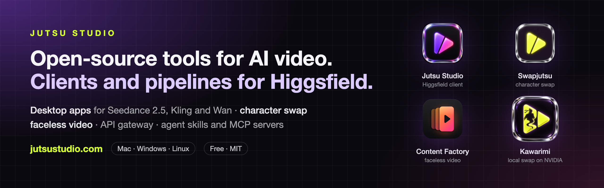

Jutsu Studio builds open-source tools for AI video generation, mostly clients and pipelines for Higgsfield.

- **Clients.** Native apps that bring Seedance 2.5, Kling, Wan and Genjutsu to your desktop and keep every result on your disk.
- **Pipelines.** Apps that run a whole job: swap a character in a video, or turn a script into a vertical video with voiceover, subtitles and music.
- **Building blocks.** An API gateway with spending caps, video trackers that run on the device, a prompt skill and MCP servers, so Claude Code and other agents can drive the apps.
- **Open data.** What AI video costs per second at each API provider, and every open-source Higgsfield alternative in one list.

The apps run on Mac, Windows and Linux. Everything here is free and MIT-licensed, and none of it is affiliated with Higgsfield, ByteDance or the other model makers.

### Mac apps

<table>
<tr>
<td align="center" width="72"></td>
<td><a href="https://github.com/jutsuhq/jutsu-studio"><b>Jutsu Studio</b></a> Open-source Higgsfield desktop app for Mac. Seedance 2.5, Kling, Wan and Genjutsu, with every result kept on your disk.</td>
<td nowrap><a href="https://github.com/jutsuhq/jutsu-studio/releases/latest">Download</a> · <a href="https://jutsustudio.com/">Site</a></td>
</tr>
<tr>
<td align="center" width="72"></td>
<td><a href="https://github.com/jutsuhq/swapjutsu-seedance-character-swap"><b>Swapjutsu</b></a> Free character swap for Mac, no watermark. Seedance 2.5 or Wan 2.2 Animate, with tracking and masks done on the Mac.</td>
<td nowrap><a href="https://github.com/jutsuhq/swapjutsu-seedance-character-swap/releases/latest">Download</a> · <a href="https://jutsustudio.com/swapjutsu/">Site</a></td>
</tr>
<tr>
<td align="center" width="72"></td>
<td><a href="https://github.com/jutsuhq/content-factory"><b>Content Factory</b></a> Open-source faceless video generator for Shorts, TikTok and Reels: a <i>What if</i> script becomes a finished vertical video. Claude Code or any MCP client can drive it.</td>
<td nowrap><a href="https://jutsustudio.com/content-factory/">Site</a></td>
</tr>
</table>

Jutsu Studio also installs with Homebrew: `brew install jutsuhq/tap/jutsu-studio`

### Windows and Linux

<table>
<tr>
<td align="center" width="72"></td>
<td><a href="https://github.com/jutsuhq/kawarimi-local-character-swap"><b>Kawarimi</b></a> Free local AI character swap for Windows and Linux. Wan 2.2 Animate on your own NVIDIA GPU, no cloud and no account. Installers for Windows, Debian and AppImage.</td>
<td nowrap><a href="https://github.com/jutsuhq/kawarimi-local-character-swap/releases/latest">Download</a> · <a href="https://jutsustudio.com/kawarimi/">Site</a></td>
</tr>
</table>

### For developers and agents

- **[edgetam-coreml](https://github.com/jutsuhq/edgetam-coreml)** · EdgeTAM video segmentation in Core ML: click once and track an object through a video on the Apple Neural Engine.
- **[edgetam-onnx](https://github.com/jutsuhq/edgetam-onnx)** · The same tracker on Windows and Linux: EdgeTAM and SAM 2.1 tiny in Rust on ONNX Runtime's CUDA provider, ~42 ms a frame.
- **[higgsfield-gateway](https://github.com/jutsuhq/higgsfield-gateway)** · Higgsfield API gateway on Cloudflare Workers, with spending caps and signed webhook verification. [Guide](https://jutsustudio.com/blog/higgsfield-api-production/)
- **[higgsfield-seedance-prompt-skill](https://github.com/jutsuhq/higgsfield-seedance-prompt-skill)** · Seedance 2.5 prompt skill for Claude, Claude Code, Codex and Cursor. [Guide](https://jutsustudio.com/blog/seedance-prompt-skill/)

### Data and lists

- **[open-source-higgsfield](https://github.com/jutsuhq/open-source-higgsfield)** · Every open-source Higgsfield alternative on GitHub: 100 projects from ComfyUI's #OpenSourceHiggsfield challenge and 6 older ones, with stars and licenses. [By category](https://jutsustudio.com/open-source-higgsfield/)
- **[ai-media-api-prices](https://github.com/jutsuhq/ai-media-api-prices)** · What one second of AI video and one AI image cost at every API provider, from the model makers to resellers and relays, checked daily. [Video](https://jutsustudio.com/video-api-pricing/) · [Images](https://jutsustudio.com/image-api-pricing/)
- **[awesome-higgsfield](https://github.com/jutsuhq/awesome-higgsfield)** · Tools, SDKs, MCP servers, agent skills and apps for Higgsfield.

Guides, comparisons and prices: **[jutsustudio.com](https://jutsustudio.com/)**
