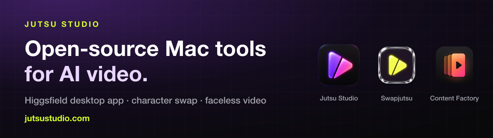

Jutsu Studio makes open-source, native Mac tools for AI video. Everything here is free and MIT-licensed, and none of it is affiliated with Higgsfield, ByteDance or the other model makers.

### Mac apps

<table>
<tr>
<td align="center" width="72"></td>
<td><a href="https://github.com/jutsuhq/jutsu-studio"><b>Jutsu Studio</b></a> Open-source Higgsfield desktop app for Mac. Seedance 2.5, Kling, Wan and Genjutsu, with every result kept on your disk.</td>
<td nowrap><a href="https://github.com/jutsuhq/jutsu-studio/releases/latest">Download</a> · <a href="https://jutsustudio.com/">Site</a></td>
</tr>
<tr>
<td align="center" width="72"></td>
<td><a href="https://github.com/jutsuhq/swapjutsu-seedance-character-swap"><b>Swapjutsu</b></a> Free character swap for Mac, no watermark. Seedance 2.5 or Wan 2.2 Animate, with tracking and masks done on the Mac.</td>
<td nowrap><a href="https://github.com/jutsuhq/swapjutsu-seedance-character-swap/releases/latest">Download</a> · <a href="https://jutsustudio.com/swapjutsu/">Site</a></td>
</tr>
<tr>
<td align="center" width="72"></td>
<td><a href="https://github.com/jutsuhq/content-factory"><b>Content Factory</b></a> Open-source faceless video generator for Shorts, TikTok and Reels: a <i>What if</i> script becomes a finished vertical video.</td>
<td nowrap><a href="https://jutsustudio.com/content-factory/">Site</a></td>
</tr>
</table>

Jutsu Studio also installs with Homebrew: `brew install jutsuhq/tap/jutsu-studio`

### For developers and agents

- **[edgetam-coreml](https://github.com/jutsuhq/edgetam-coreml)** · EdgeTAM video segmentation in Core ML: click once and track an object through a video on the Apple Neural Engine.
- **[edgetam-onnx](https://github.com/jutsuhq/edgetam-onnx)** · The same tracker on Windows and Linux: EdgeTAM and SAM 2.1 tiny in Rust on ONNX Runtime's CUDA provider, ~42 ms a frame.
- **[higgsfield-gateway](https://github.com/jutsuhq/higgsfield-gateway)** · Higgsfield API gateway on Cloudflare Workers, with spending caps and signed webhook verification. [Guide](https://jutsustudio.com/blog/higgsfield-api-production/)
- **[higgsfield-seedance-prompt-skill](https://github.com/jutsuhq/higgsfield-seedance-prompt-skill)** · Seedance 2.5 prompt skill for Claude Code, Codex and Cursor. [Guide](https://jutsustudio.com/blog/seedance-prompt-skill/)

### Data and lists

- **[video-api-prices](https://github.com/jutsuhq/video-api-prices)** · What one second of AI video costs at 30+ API providers, updated daily. [Table](https://jutsustudio.com/video-api-pricing/)
- **[awesome-higgsfield](https://github.com/jutsuhq/awesome-higgsfield)** · Tools, SDKs, MCP servers, agent skills and apps for Higgsfield.

Guides, comparisons and prices: **[jutsustudio.com](https://jutsustudio.com/)**
